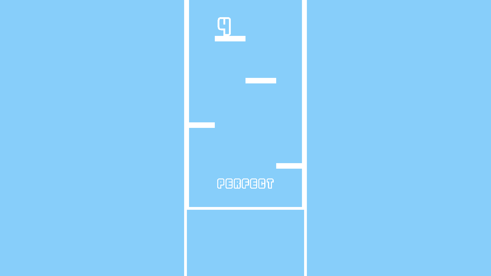

# SkyBlue

하늘색 화면 위로 떨어지는 노트를 **D · F · J · K**로 연주하는 Python/Pygame 4키 리듬 게임입니다. 2023년 게임프로그래밍입문 프로젝트의 원본 소스를 보존한 아카이브입니다.



## 플레이

네 개의 레인에 떨어지는 흰색 노트가 아래쪽 판정선에 도착할 때 해당 키를 누릅니다.

| 왼쪽부터 레인 | 1 | 2 | 3 | 4 |
| --- | --- | --- | --- | --- |
| 키 | D | F | J | K |

창의 닫기 버튼으로 종료합니다.

## 실행

Python 3과 Pygame이 필요합니다. 아래 명령은 저장소의 루트 폴더에서 실행합니다. 폰트와 효과음이 상대 경로로 로드되므로 실행 위치를 유지해 주세요.

```sh
git clone https://github.com/minsub1489/SkyBlue.git
cd SkyBlue
python -m venv .venv
```

가상 환경을 활성화합니다.

```sh
# macOS / Linux
source .venv/bin/activate

# Windows PowerShell
.venv\Scripts\Activate.ps1
```

```sh
python -m pip install -r requirements.txt
python Skyblue.py
```

## 구현

- 1600 × 900 화면과 초당 최대 60프레임의 게임 루프
- 0.2초 간격의 랜덤 노트 생성과 연속으로 같은 레인을 선택하지 않는 규칙
- 경과 시간과 노트의 목표 시각을 사용하는 낙하 위치 계산
- 타이밍 차이에 따른 PERFECT · GREAT · GOOD · BAD · WORST 판정
- GOOD 이상에서 콤보 증가, BAD · WORST · Miss에서 콤보 초기화
- 입력 레인의 시각 효과, 판정·콤보 텍스트 애니메이션, 물방울 효과음

현재 소스는 랜덤 노트를 사용하는 프로토타입입니다. 배경 음악·곡별 채보·음악 비트 동기화·난이도 선택·결과 화면은 구현되어 있지 않습니다.

## 파일

```text
Skyblue.py                 원본 게임 소스
water_droplet.wav           입력 효과음
font/ingame_font.ttf        SF레몬빙수 폰트
font/NOTICE.md             폰트 출처와 사용 조건
docs/gameplay.png           원본 소스 렌더링 화면
requirements.txt           검증에 사용한 Pygame 버전
```

게임 소스의 SHA-256은 `aa7b39cae6db86ff0ac31a3138dbfda17cb19940e198021007e2d4ee244fd79e`입니다. 원본 제출 문서와 Windows 실행 파일은 포함하지 않았습니다.

## 실행 확인

2026-10-11, Python 3.13.13 / Pygame 2.6.1의 SDL dummy video·audio 환경에서 원본 코드를 실행했습니다. 자동 입력으로 151프레임, PERFECT 판정과 5콤보, 창 닫기 이벤트에 의한 종료를 확인했습니다. 위 이미지는 이 실행에서 게임의 실제 렌더링 표면을 저장한 화면입니다. 일반 창의 수동 플레이와 실제 스피커 출력까지 검증한 기록은 아닙니다.

## 자산

폰트는 눈서리의 **SF레몬빙수 (SF_IceLemon)** 입니다. [폰트 안내](font/NOTICE.md)를 참고해 주세요. `water_droplet.wav`는 당시 프로젝트에 포함된 효과음이며 별도 제작자·라이선스 기록은 남아 있지 않습니다. 자산의 단독 재사용 권한이나 전체 프로젝트에 대한 포괄적 라이선스를 새로 부여하지 않습니다.
